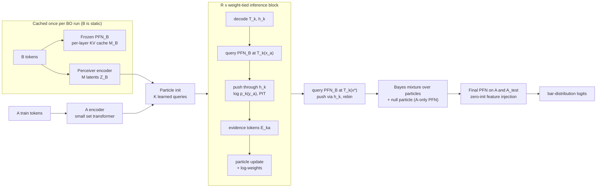

# MetaPFN — "A → B" transfer architecture with an explicit Bayes update over transforms

*Design note. Status: proposed. It supersedes the OT-based alignment idea, which was abandoned (see §7).*

**Notation**

- $A$ — the target task: $n_A \in [0,20]$ observations, initial design plus a few BO steps.
- $B$ — the related task: $N_B \sim 10^2$–$10^3$ observations, acquisition-biased.
- Queries: $x^*$ are test locations in $A$.
- $y$ is normalised to $[0,1]$ by the global prior ECDF.

**Generative assumption in the prior**

$$f_A(x) = h\big(f_B(T(x))\big) + r(x), \qquad T: \mathcal X_A \to \mathcal X_B,\;\; h:[0,1]\to[0,1]\ \text{monotone},\;\; r \text{ a residual.}$$

$T$ and $h$ come from a broad, generic prior: random smooth warps plus shifts, and random monotone output maps. They are *not* an enumerated list of known relations. The relations named so far (dataset difficulty, µP, regularisation vs. data size) only motivate the family.

---

## 1. Core idea in one paragraph

Do **not** move B into A. Move **A's train points and A's test queries into B's domain**, and read B through the (cached, frozen) single-task PFN as a queryable surrogate. The unknown $(T, h)$ is represented by $K$ **particles** (hypotheses). Each particle is scored by an **explicit likelihood** of A's observations under that hypothesis, which gives an actual Bayes update over transforms.

Information from B reaches each test point **directly**: by querying B's PFN at $T_k(x^*)$, with the full $N_B$-token memory. It never passes through the $n_A$ train tokens of A. A's tokens only have to identify the transform, which is a low-dimensional object. **This removes the bottleneck you were worried about.**

---

## 2. Components



### 2.1 Cached B side (computed once per BO run)

| Module | What | Shape | Trainable |
|---|---|---|---|
| `PFN_B` | Your pretrained single-task PFN, run on $B$ as train set. Keep the **per-layer** keys/values of B's train tokens. | $L_B \times N_B \times D_B$ | frozen |
| `Q_B(x)` | "Query operator": push a test token $e(x)$ through the $L_B$ layers, cross-attending to the cached B states, then decode. Returns the last hidden state $\mathbf s_B(x)\in\mathbb R^{D_B}$ and bar logits $\boldsymbol\ell_B(x)\in\mathbb R^{G}$. | per query | frozen, **differentiable in $x$** |
| `Perceiver_B` | $M$ learned latents cross-attend to B's tokens, followed by a few latent self-attention layers. Gives a compact summary $Z_B\in\mathbb R^{M\times D}$ (where B's good region is, landscape shape, scale). | $M \times D$, $M\approx 32$–$64$ | yes |

`Q_B` is exactly the PFN's normal test-token path, so querying B at an arbitrary location is just kernel-style interpolation, which attention does well. Gradients flow through `Q_B` into the transform $T_k$, so the transform is learnable end to end.

> Perceiver IO fits here naturally, but only as the **summary** of B for proposing and looking up transforms. For the predictive itself, use the pretrained PFN's own query path, which is exact and already trained. You *could* replace `Q_B` by a Perceiver-IO decoder over $Z_B$ to save compute ($O(M)$ instead of $O(N_B)$ per query), at the price of a lossy summary.

### 2.2 Particle representation (the "transform proposal" layers)

Each particle is a token $P_k\in\mathbb R^D$, for $k=1..K$ with $K\approx 16$–$64$. Two small **decoders** turn it into explicit maps:

- **Input warp** (hypernetwork / FiLM MLP, residual around identity):
  $$T_k(x) = \operatorname{clip}\big(x + \Delta_\phi(x;\,P_k)\big), \qquad \Delta_\phi = \text{MLP}\big([\gamma(x),\,P_k]\big),$$
  - $\gamma$ is a Fourier/positional embedding of $x$.
  - $\gamma(x) = [\,x,\ \sin(2\pi Wx),\ \cos(2\pi Wx)\,]$ are Fourier features. $W$ is either fixed octaves or random Gaussian with a few scales. An MLP on raw low-dimensional $x$ can only make very smooth corrections (spectral bias), and Fourier features let $\Delta$ vary locally. You can also reuse the PFN's own $x$-encoder. For shift-only $T$, $\gamma$ is not needed.
  - Initialise $\Delta\approx0$, so every particle starts at the identity.
  - Shifts, per-dimension warps and cross-dimension couplings are all expressible. No enumeration needed.
  - $T_k$ does **not** have to be invertible. Collapsing a dimension (e.g. "regularisation stops mattering") is allowed, which is a key advantage of the A→B direction.
- **Output map** (monotone, on the bar grid with edges $e_0<\dots<e_G$ in $[0,1]$):
  $$h_k(e_i) = \sum_{j\le i}\operatorname{softmax}(W_h P_k)_j, \quad\text{piecewise linear between edges. Initialise to the identity.}$$

**Initialisation block** (DETR-style: $K$ learned query embeddings $Q^{(0)}$):

```
P = Q0                                  # [K, D] learned
P = P + XAttn(P, Z_B)                   # what B looks like
P = P + XAttn(P, [H_A ; sink])          # what A looks like (sink token handles n_A = 0)
P = P + SelfAttn(P);  P = P + MLP(P)    # spread hypotheses
```

$H_A$ = output of a small A-encoder (2–4 self-attention layers over A's $(x,y)$ tokens).

### 2.3 Weight-tied inference block (run $R$ times — the "operator" part)

For each particle $k$ and each A point $a$:

1. **Decode:** compute $T_k$ and $h_k$ from $P_k$.
2. **Query B at the transported location:** $(\mathbf s_{ka},\boldsymbol\ell_{ka}) = Q_B\big(T_k(x_a)\big)$. All $K\cdot n_A$ queries are batched.
3. **Push through $h_k$ (exact for a bar distribution).** Bin $i$ with mass $\pi_i$ moves to $[h_k(e_i),h_k(e_{i+1})]$. Its density becomes $\pi_i/(h_k(e_{i+1})-h_k(e_i))$. From this, compute:
   - the **log-likelihood** $\lambda_{ka} = \log p_k(y_a)$;
   - the **PIT** $u_{ka}=F_k(y_a)$, which tells whether $y_a$ is higher or lower than the hypothesis predicts. This is the signal for correcting $h$.

   For robustness, use $p_k = (1-\varepsilon)\,p_k^{\text{push}} + \varepsilon\,\text{Unif}$ with a small $\varepsilon$, so a single outlier can't zero out a particle.
4. **Evidence tokens** $E_{ka}\in\mathbb R^D$:
   $$E_{ka} = \text{MLP}\big([\,\gamma(x_a),\ \gamma(T_k(x_a)),\ e_y(y_a),\ W_s\mathbf s_{ka},\ \lambda_{ka},\ u_{ka}\,]\big) + P_k$$
5. **Evidence mixing:**
   - `SelfAttn` over $\{E_{ka}\}_a$ *within* each particle. This lets the block see that "points 1 and 3 disagree in the same direction".
   - `XAttn(E_ka → Z_B)`, a **local correspondence lookup**: "where in B does a value like $h_k^{-1}(y_a)$ occur near $T_k(x_a)$?". This is the useful remnant of the soft-matching idea, now per particle and local, with no OT.
6. **Particle update:**
   ```
   P_k = P_k + XAttn(P_k, [E_k,1..n_A ; sink])     # read own evidence
   logw_k = prior_head(P_k) + beta * sum_a lambda_ka
   P_k = P_k + Linear([logw_k, rank(logw_k)])      # tell particles how good they are
   P = P + SelfAttn(P);  P = P + MLP(P)            # interact: move bad particles, keep diversity
   ```

   This is a *learned* SMC/EM move kernel. The likelihood part of the weights is explicit; the move is learned.

**Weights = the Bayes update over transforms:**

$$\log w_k \;=\; \underbrace{\log \pi_\theta(P_k)}_{\text{learned prior / proposal correction}} \;+\; \beta\sum_{a=1}^{n_A}\log p_k(y_a\mid x_a, B),\qquad w=\operatorname{softmax}(\log w).$$

- The likelihood term is the actual model evidence for hypothesis $k$, computed by the PFN.
- $\pi_\theta$ is learned because particles come from a learned proposal, so the prior/proposal ratio is not available in closed form.
- $\beta$ (learned, initialised to 1) tempers the **pseudo-likelihood**. The product over $a$ treats A's points as conditionally independent given B, which over-counts when B is uncertain at the transported locations.
- With $n_A=0$, the weights equal the learned prior. That is the correct Bayes behaviour.

**Training $R$:** sample $R\sim\{1,\dots,R_{\max}\}$ per batch (with $R_{\max}\approx 4$–$8$) and apply deep supervision at every iteration. This gives anytime / operator-like behaviour, and you can run more iterations at test time.

### 2.4 Null particle ("B is unrelated")

Add particle $k=0$ whose predictive is the **A-only PFN**, $p_0(y\mid x) = \text{PFN}(y\mid x, A)$. Its log-weight uses a leave-one-out likelihood of A: in a single forward pass with a diagonal attention mask, each A point is predicted from the others. This makes the comparison between "related under some $(T,h)$" and "unrelated" an explicit Bayesian model comparison. It covers negative transfer and anything outside the transform family.

### 2.5 Prediction (stage 3)

For each test point $x^*$:

1. **Per-particle predictive:** $p_k(y\mid x^*) = \operatorname{rebin}\big(h_k\#\,Q_B(T_k(x^*))\big)$.
   - "Rebin" means: evaluate the pushed CDF at the standard bar edges by linear interpolation, then take differences. This is exact and differentiable.
   - Cost: $K\cdot n_{\text{test}}$ queries into the cached B.
2. **Bayes model average:**
   $$p_{\text{mix}}(y\mid x^*) = \sum_{k=0}^{K} w_k\, p_k(y\mid x^*).$$
   This is the explicit posterior predictive under the model "$f_A = h\circ f_B\circ T$ exactly, or unrelated".
3. **Final PFN for residuals and misspecification.** Use a PFN on $[A_{\text{train}}, A_{\text{test}}]$, **initialised from your pretrained single-task PFN**, with injected features:
   - **test tokens:** $\text{inj}(x^*) = W_1\log p_{\text{mix}}(\cdot\mid x^*) + W_2\sum_k w_k\, W_s\mathbf s_B(T_k(x^*))$, i.e. the mixture distribution plus a weighted B-hidden-state;
   - **train tokens:** the same at $x_a$, plus the PIT of $y_a$ under $p_{\text{mix}}$, so the final PFN sees *where and how* the mixture is wrong (the residual $r$).
   - **Zero-initialise** $W_1, W_2$. At initialisation the whole model is then exactly the A-only PFN, i.e. your lower bound. Training can only add value by learning to use B, which removes the "easier to ignore B" trap at the start.
   - *Optional:* a gated logit prior, $\text{logits} = \text{PFN}_{\text{final}} + g(x^*)\log p_{\text{mix}}$, with $g$ initialised to 0.

**Why this removes the bottleneck:** B's information enters each test token through $Q_B(T_k(x^*))$, i.e. the full B memory queried at the right place. A's $n_A$ tokens only need to carry enough information to *pin down $(T,h)$*, and the particles hold that. B's own prior information about plausible transforms enters through $Z_B$ in the initialisation and the lookup. **Nothing B-specific has to squeeze through A's tokens.**

---

## 3. Cost

| Part | Cost | When |
|---|---|---|
| `PFN_B` encode, `Perceiver_B` | $O(L_B N_B^2 D_B)$, $O(MN_B D)$ | once per BO run |
| Inference block | $R\cdot K\cdot n_A\cdot L_B\cdot N_B$ query attention + $O(K n_A^2 + K^2)$ | per BO step |
| Prediction | $K\cdot n_{\text{test}}\cdot L_B\cdot N_B$ | per BO step |

Example: $K{=}32$, $n_A{=}20$, $R{=}4$, $L_B{=}12$, $N_B{=}2000$ gives about $6\cdot10^7$ dot products per step for inference. That's negligible. Prediction scales with the number of acquisition candidates, so batch it, or use the Perceiver-IO decoder for screening and `Q_B` for the top candidates.

---

## 4. Losses, including the LUPI / Rao–Blackwell part

| Loss | Target | Purpose |
|---|---|---|
| $\mathcal L_{\text{NLL}}$ | $y^*$ | main objective. The minimiser is the PPD $p(y\mid x^*,A,B)$. |
| $\mathcal L_{\text{KD}}$ | teacher $t_{T,h} = \text{PFN}(y\mid x^*, A\cup B_{\text{in}A})$, frozen pretrained single-task PFN | same optimum as NLL, lower-variance gradients (§5) |
| $\mathcal L_{\text{mix}}^{(r)}$ | $y^*$ (NLL of $p_{\text{mix}}$ after every iteration $r$) | deep supervision of particles and weights |
| $\mathcal L_{T}$ | privileged true $(T,h)$ | breaks the chicken-and-egg problem (§5.2) |

**$\mathcal L_T$, specified in function space.** Build the **oracle particle** $p^\star(y\mid x) = h\#Q_B(T(x))$ using the *true* $T,h$; this is cheap, just one more query. Then use a multiple-hypothesis (relaxed winner-takes-all) loss:

$$\mathcal L_T = \sum_k \alpha_k\, \frac{1}{|S|}\sum_{x\in S} \mathrm{KL}\big(p^\star(\cdot\mid x)\,\|\,p_k(\cdot\mid x)\big),\qquad \alpha_k = \begin{cases}1-\delta & k=\arg\min\\ \delta/(K-1)&\text{else}\end{cases}$$

- $S$ = A's train locations plus test locations.
- The small $\delta$ keeps all particles alive (as in multiple-hypothesis prediction).

Why function space rather than comparing $T_k$ to $T$ directly: $T$ is not identifiable along directions where $f_B$ is flat, and a function-space loss ignores differences that don't change predictions.

$\mathcal L_T$ trains particle **positions** only. The **weights** are trained by $\mathcal L_{\text{mix}}$ and $\mathcal L_{\text{NLL}}$, so they stay posterior weights rather than "which particle is closest" classifier outputs. Anneal $\mathcal L_T$ toward 0 late in training.

**Curriculum** (also a debugging ladder):

1. $T{=}h{=}\text{id}$: $p_{\text{mix}}$ should beat A-only immediately. If it doesn't, the bug is in plumbing.
2. $h$ only.
3. Shifts.
4. Full warp prior.
5. Add residual $r$ and unrelated tasks.

---

## 5. LUPI distillation = Rao–Blackwellisation (the assessment, carried over)

### 5.1 What distillation from the privileged teacher does and doesn't do

Let $t_{T,h}(y) = p(y\mid x^*, A, B, T, h)$, i.e. the PPD given the true transform. That's what the teacher computes via $A\cup B_{\text{in}A}$. With the **forward** KL / soft-label CE loss,

$$\mathbb E_{T,h\mid A,B}\big[\mathrm{KL}(t_{T,h}\,\|\,q)\big] = \mathbb E\big[-\textstyle\sum_y t_{T,h}(y)\log q(y)\big] + \text{const},$$

the minimiser is

$$q^\star = \mathbb E_{T,h\mid A,B}\big[t_{T,h}\big] = \int p(y\mid x^*,A,B,T,h)\,p(T,h\mid A,B)\,dT\,dh = p(y\mid x^*,A,B).$$

That is **the same optimum as plain NLL**. The NLL label $y^*$ is one sample from $t_{T,h}$; the teacher replaces that sample by its conditional expectation. This is Rao–Blackwellisation: same expected gradient, lower variance.

Consequences:

- ✅ Keep it. It gives denser, less noisy gradients, especially for small $n_A$, where single-sample labels are very noisy.
- ❌ It **cannot force the student to recover $T$.** If $(T,h)$ is not identifiable from $(A,B)$, the correct student output *is* the mixture over transforms. "Not recovering $T$" may simply be correct behaviour.
- ⚠️ Use **forward** KL. Reverse KL is mode-seeking: it would commit to one transform and be overconfident.
- ⚠️ Teacher error becomes student bias. Using the frozen pretrained single-task PFN as teacher (no EMA, no stop-gradient issues) is fine as long as it's accurate at $n_A + N_B$ context sizes. Check its calibration there first.

### 5.2 Where privileged information gives a *genuinely different* signal

The privileged $(T,h)$ helps when used to supervise an **intermediate latent** (the particles via $\mathcal L_T$), not the output. This does not change the Bayes optimum of the output; the weights still come from likelihoods. What it changes is the optimisation path. Early in training, the output barely depends on B, so the NLL gradient toward using B is tiny. $\mathcal L_T$ gives the transform module a direct, dense signal from step one.

### 5.3 First check: is there anything to gain?

Compare on the prior:

1. A-only NLL — the lower bound.
2. Teacher NLL with the true $B_{\text{in}A}$ — the upper bound; privileged, so not achievable.
3. A **Bayes-achievable** estimate on a small toy: 1-D, $T$ = a shift, $h$ = affine. Grid over $(T,h)$ and weight each grid point by the single-task PFN likelihood of $A$.

If (3) ≈ (1) for $n_A\le5$, the information is not in the data under that transform prior, and no architecture will extract it; narrow the prior instead. The gap (2) − (3) is the price of not knowing $(T,h)$, and the gap (3) − model is what the architecture should close.

**Diagnostics to log during training:**

- **Particle coverage:** $\min_k \mathrm{KL}(p^\star\|p_k)$.
- **Weight calibration:** the posterior mass on near-oracle particles, binned against how often they really are the oracle.
- **Null-particle weight** vs. the true relatedness in the prior.

---

## 6. Open risks

- **Pseudo-likelihood over-confidence.** $\beta$ helps. If it's not enough, use prequential scoring: append the already-transported A points as extra keys in `Q_B` with a causal mask. B's cache stays valid because B tokens never attend to A.
- **$T_k(x)$ leaving $[0,1]^d$.** The frozen PFN is out of distribution there. Clip, add an "outside" flag feature, or fine-tune `PFN_B` with a small query margin. This region is also where B is uninformative, so the null particle and the final PFN should take over.
- **Biased B designs.** The pretrained `PFN_B` must have seen clustered, acquisition-like designs during pretraining. Otherwise its cached posterior is itself out of distribution.
- **High $d$.** The transform space grows, so $K$ particles may not cover it. The refinement blocks, B-conditioned initialisation and the lookup are what make $K\approx32$ workable. Monitor coverage as a function of $d$.
- **Non-monotone $h$ / other objectives.** Not representable by $h_k$. They fall to the residual stage and the null particle by design.
- **Several related tasks.** Use one particle set per task with a shared block. The final injection pools over tasks with attention, so this is permutation-invariant in $K_{\text{tasks}}$.

---

## 7. Clarifications

### 7.1 Which y-scale is used where

- The query path `Q_B` sees **only B**, so its output is in **B's y-scale**.
- $h_k$ converts that output to A's scale **explicitly**, before any comparison with $y_a$ or $y^*$.
- The losses are always computed in **A's scale**: the query location is $T(x^*)$, but the label is $y^*$ in A's own scale.
- **Rule:** never let A's $y$ values enter B-side attention in A's scale. If transported A points are ever appended to B's context (the prequential option, or the LUPI teacher below), add them as $\big(T_k(x_a),\ h_k^{-1}(y_a)\big)$. $h_k$ is strictly increasing, so it is invertible.

  Otherwise attention silently mixes the two scales. It would then learn part of $h$ implicitly while $h_k$ is applied again explicitly, which corrupts the likelihood and therefore the Bayes weights.

### 7.2 $A_{\text{in}B}$ as privileged information

In the prior, the true transported A set $A_{\text{in}B} = \{(T(x_a),\, h^{-1}(y_a))\}$ is known, and so is $T(x^*)$. Uses:

- **Location supervision**, only while $T$ is identifiable (e.g. $h=\text{id}$): a loss on $\lVert T_k(x_a) - T(x_a)\rVert^2$ and on $\lVert T_k(x^*) - T(x^*)\rVert^2$.
- **A B-space teacher:** $h\#\,\text{PFN}\big(y\mid T(x^*),\ B\cup A_{\text{in}B}\big)$. It is Rao–Blackwell in exactly the same sense as §5, with the same optimum as NLL and lower variance. It is complementary to the A-space teacher $\text{PFN}(A\cup B_{\text{in}A})$; both are cheap.

### 7.3 $T$ and $h$ trade off against each other

Prediction depends only on the composite $g = h\circ f_B\circ T$. Different pairs can give the same $g$.

- Extreme example: for a monotone 1-D $f_B$, any $h$ can be absorbed into $T$, since $h\circ f_B\circ T = f_B\circ(f_B^{-1}\circ h\circ f_B\circ T)$.
- In general, a flexible $T$ can move points onto whichever level set $h$ would have produced. So with few A points, $h$ is only weakly identifiable.

**Decode them separately anyway**, because:

- monotone, invertible $h$ is what makes the scale handling of §7.1 clean;
- the *prior* decides between equivalent explanations: smooth/simple $T$ and simple $h$ are favoured, through the decoder parameterisation and the learned prior weight;
- equivalent particles predict the same thing, so the mixture is unaffected; they are just duplicates.

**Do not supervise $T$ and $h$ separately once both vary.** Supervise the composite in function space ($\mathcal L_T$ in §4), which is invariant to the trade-off. Direct parameter or location losses are fine only in experiments where one of the two is fixed.

### 7.4 PIT (probability integral transform)

$u = F(y_{\text{obs}})$, the predictive CDF evaluated at the observed value.

- Under a calibrated predictive, $u\sim\text{Unif}(0,1)$.
- $u\approx1$: the observation is higher than predicted. $u\approx0$: lower.
- It is a bounded, scale-free residual that can be compared across tasks. That makes it a good input feature. Across A's points, the pattern of PIT values directly indicates how $h$ is wrong: all values near 1 means shift up; a U-shaped histogram means the predictive is too narrow, so stretch.

---

## 8. Sanity-experiment ladder (single hypothesis first)

The goal is to test the **location mapping** in isolation before adding $h$, multiple particles, biased designs and residuals.

**Shared setup:**

- $f_B\sim$ the BNN prior and $f_A(x) = f_B(T(x))$, so $h=\text{id}$ until S4.
- $T(x)=x+s$ with $s\sim\mathcal U(-0.2,0.2)^d$, for $d\in\{1,2\}$.
- Sample A's $x$ so that $T(x)\in[0,1]^d$. Relax this later.
- B: uniform design with $N_B=200$ first, biased later.
- $n_A\in\{0,1,2,5,10\}$.
- Use the frozen pretrained PFN throughout.

| Step | What | Measures | Passes if |
|---|---|---|---|
| **S0 Plumbing / oracle** | No learning. Predict $y^*$ with: (a) A-only PFN, (b) the oracle particle $Q_B(T(x^*))$ with the true $s$, (c) the teacher $\text{PFN}(A\cup B_{\text{in}A})$. | NLL vs. $n_A$ | (b) ≈ (c) ≪ (a). This validates `Q_B`, caching, rebinning and scale handling. |
| **S1 Non-amortised ceiling** | Grid over $s$ (201 points for $d=1$, $41^2$ for $d=2$). Pseudo-log-likelihood $\sum_a\log p(y_a\mid Q_B(x_a+s))$ gives a posterior over $s$ and a grid-Bayes predictive. Also run gradient descent on $s$ from $0$ through `Q_B`. | NLL of grid-Bayes; error of $\hat s_{\text{MAP}}$; posterior entropy and **fraction of unimodal posteriors**; GD success rate | Shows how much B can give at each $n_A$, and **when one hypothesis is enough** (unimodal fraction). If GD fails often, the landscape is rugged, which argues for refinement blocks or more particles. |
| **S2 Amortised, single particle, shift only** | One particle token, init block + $R$ weight-tied evidence blocks; decoder $T(x)=x+s(P)$. Losses: NLL of $Q_B(T(x^*))$ on A_test, deep supervision on A_train, plus $\lVert s-s_{\text{true}}\rVert^2$ (privileged, valid here). Ablations: $R=0$ (one-shot regression from A and $Z_B$) vs. $R>0$; with/without the evidence lookup. | $s$ error vs. S1 MAP; NLL gap to grid-Bayes; split by unimodal/multimodal S1 posteriors | Matches S1 MAP on unimodal cases and closes most of the NLL gap between A-only and grid-Bayes. Expect failures on multimodal cases: the MSE loss averages between modes, which is the motivation for $K>1$. |
| **S3 Richer warps** | Shift + per-dimension monotone warp (e.g. Kumaraswamy CDF); decoder $x+\Delta(\gamma(x),P)$. Supervise locations $T(x_a)$ and $T(x^*)$ (valid while $h=\text{id}$). | location RMSE at A and test points; NLL | Same criteria as S2 |
| **S4 Add $h$** | Affine $h$ first, then monotone. Switch to the composite function-space loss. | composite KL; separate $T$/$h$ errors, to *observe* the trade-off rather than penalise it | NLL holds up; composite error is small even when $T$ and $h$ individually drift |
| **S5 Full** | $K>1$ with Bayes weights, null particle, biased designs, residual $r$, final PFN | everything in §5.3 | — |

The S1 grid search costs $\#\text{grid}\times n_A$ queries into a cached B, which is cheap for $d\le2$. It is also the reference against which every amortised variant should be judged.

---

## 9. Why not OT (decision log)

OT couples **point sets**. A and B are different samples of two functions at policy-determined locations, so no point-level correspondence exists. The required object is a **function registration** $f_A \approx h\circ f_B\circ T$. Moving B into A also needs an invertible $T$, transports $N_B$ tokens, and breaks caching.

What survives from the OT discussion:

- **local soft lookup** of plausible correspondences (§2.3, step 5);
- **monotone 1-D maps for $y$**, now as $h_k$;
- the **Rao–Blackwell view of the privileged teacher** (§5).

---

## Appendix A: the Q&A that produced §7 and §8 (user, 2026-10-28)

Source: `~/Downloads/metapfn_A_to_B_architecture (1).md` (this file, verbatim above this appendix) and the user's
chat summary of the changes. Every point below is already in §7/§8; it is kept as the record of the questions.

- **Scale mismatch when A_test moves into B.** Not a problem while the B query path only ever sees B: its output is
  in B's y-scale, and $h_k$ converts it to A's scale explicitly before anything is compared with $y_a$ or $y^*$. The
  loss is computed in A's scale (query *at* $T(x^*)$, label $y^*$ in A's own scale). It becomes real if A's points
  are ever added to B's attention context (prequential option, B-space teacher): they must then go in as
  $(T_k(x_a), h_k^{-1}(y_a))$; otherwise attention mixes scales, learns part of $h$ implicitly, $h_k$ is applied on
  top, and the Bayes weights are corrupted. $h_k$ is strictly increasing, so the inverse exists (§7.1).
- **$A_{\text{in}B}$ for LUPI.** Location supervision $\lVert T_k(x_a) - T(x_a)\rVert^2$ only while $T$ is
  identifiable (e.g. $h$ = id); a second, B-space teacher: B's PFN on $B \cup A_{\text{in}B}$, queried at $T(x^*)$,
  pushed through $h$ (Rao–Blackwell, same optimum as NLL, lower variance) (§7.2).
- **$\gamma(x)$** = Fourier features; not needed for shift-only; the PFN's own x-encoder can be reused (§2.2).
- **$T$ and $h$ trade off**: decode separately, supervise the composite in function space once both vary (§7.3).
- **PIT** $u = F(y_{\text{obs}})$: a bounded, scale-free residual feature (§7.4).
- **Sanity ladder S0–S5**, single hypothesis first; S0 and S1 need no training (§8).

## Appendix B: how this repo runs S0/S1 (issue #16, notebook 08, 2026-10-28)

- The frozen PFN is `pfn_large` from pfn-repro v0.1.0, the variable-d checkpoint (training prior x_dim = 6,
  variable_dim_min = 1), trained on contexts $n \le 100$. The note's $N_B = 200$ is outside that range, so the main
  arm uses $N_B = 80$ ($N_B + n_A \le 90$). $N_B = 200$ runs only as a labelled out-of-range probe.
- The A-space teacher $\text{PFN}(A \cup B_{\text{in}A})$ keeps only the B points whose $x_b - s$ lies in
  $[0, 1]^d$ (the PFN's training box). The B-space teacher $\text{PFN}(B \cup A_{\text{in}B})$ at $T(x^*)$ is reported
  next to it.
